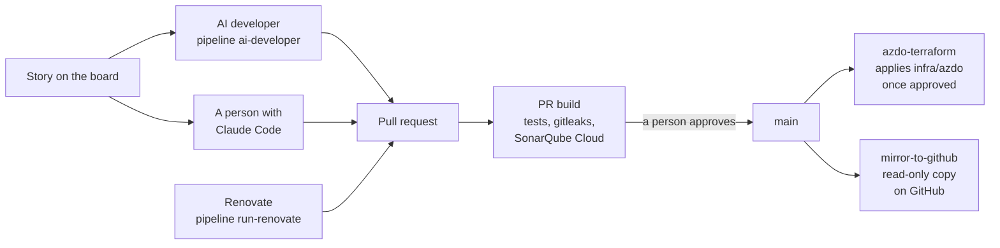

# GroundWerk

GroundWerk is a starter kit for teams that build .NET 10 services on Azure with Azure DevOps. Its AI developer takes stories from the board to pull requests, and a person approves every merge and infrastructure change. The guardrails around the AI developer apply to every change, whoever makes it, so a team that doesn't want one can still use any of them.

## How a change reaches main

## What's in it

Each part has an ADR in docs/adr, which records the decision and the alternative it was chosen over.

- **Gated pull requests.** Every change is a PR whose build runs the tests, scans the commits for secrets with gitleaks and has to pass SonarQube Cloud's quality gate, and a person approves every merge ([ADR 8](docs/adr/0008-pr-build-gates-on-sonarqube-and-gitleaks.md)).
- **One build everywhere.** `dotnet run build.cs` builds and tests the same way on every machine and in the pipelines ([ADR 5](docs/adr/0005-one-build-script.md)), in one image for the dev container and the build ([ADR 7](docs/adr/0007-one-dev-and-build-image.md)).
- **Azure DevOps as code.** The Terraform in infra/azdo sets up Azure DevOps itself, from the repos' branch policies to the pipelines and their permissions, and environment names come from a private Settings repo, so the public files hold none ([ADR 12](docs/adr/0012-environment-names-come-from-settings.md)).
- **Dependencies kept current.** Renovate opens the PRs that keep packages and pipeline templates up to date, as its own identity, and builds hold to minimum versions ([ADR 10](docs/adr/0010-renovate-and-minimum-versions.md)).
- **Shared code by version.** The pipeline templates and the shared packages each have a repo of their own, GroundWerk.PipelineTemplates and GroundWerk.InnerSource, and release by tag, while code that only this solution uses stays a project in it ([ADR 1](docs/adr/0001-one-repo-one-solution.md) and [ADR 9](docs/adr/0009-innersource-packages-and-releases.md)). The packages also go to nuget.org from GitHub through Trusted Publishing, so no key is stored ([ADR 14](docs/adr/0014-releases-go-to-nuget-org-from-github.md)).
- **A sample app to build on.** One host runs as the API, or as the jobs when started with `--Role=jobs`, and Domain, Application, Infrastructure, Contracts and Database projects are ready for a service's code ([ADR 2](docs/adr/0002-one-host-two-roles.md)). An Aspire AppHost runs it locally ([ADR 3](docs/adr/0003-run-locally-with-the-apphost.md)), and the tests make their own Always Encrypted keys ([ADR 4](docs/adr/0004-tests-make-their-own-always-encrypted-keys.md)).
- **The AI developer.** It's a Claude Agent SDK program that pipeline ai-developer runs as its own identity. It signs in with workload identity federation instead of stored keys, can push only its own branches, and its PRs go through the same gates and approval as anyone's ([ADR 6](docs/adr/0006-ai-developer-signs-in-with-workload-identities.md)). People can take stories to PRs too, through a Claude Code skill ([ADR 11](docs/adr/0011-stories-go-to-prs-through-a-claude-code-skill.md)).

## Quickstart

You need Docker and VS Code with the Dev Containers extension, on an x64 machine, since the image is built for x64 only. The dev container has the .NET SDK and every tool this repo uses.

1. Clone the repo, inside WSL if you're on Windows. The dev container mounts ~/.azure and ~/.ssh/known_hosts, for the Azure CLI and SSH, and Docker won't start it if either is missing, so create them if you need to: `mkdir -p ~/.azure ~/.ssh && touch ~/.ssh/known_hosts`.
2. Open the repo in VS Code and choose **Reopen in Container**.
3. In the dev container's terminal, build and test with `dotnet run build.cs`, the same command the pipelines run, which puts its output in artifacts/. Every package comes from nuget.org, so the restore needs no sign-in.
4. Run it with `dotnet run --project src/GroundWerk.AppHost`, which starts the Host as the API and as the jobs and prints a link to the Aspire dashboard, with their traces, metrics and logs. In VS Code, F5 does the same with the debugger attached.

That runs GroundWerk on your machine. Setting it up in your own Azure DevOps organization, with its Settings repo, identities and infra/bootstrap, isn't written down yet.

## Contributing

The repos live in Azure DevOps, and this copy on GitHub is a read-only mirror of main and the tags ([ADR 13](docs/adr/0013-main-and-tags-are-mirrored-to-github.md)), so a pull request opened on GitHub isn't merged. AGENTS.md has the layout, the conventions, how branches, commits and PRs are named, and the Definitions of Done and Ready.

## License

MIT, as LICENSE says.
