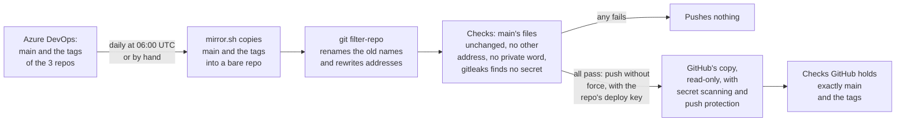

# 13. Main and the tags are mirrored to GitHub with their whole history, the old names renamed and every address rewritten, through a deploy key per repo

Status: Accepted

## Context

The project's repos are mirrored to repos on GitHub, so the work shows in a portfolio (DR-10), from each repo's first commit on. A secret pushed to a public repo can't be taken back, so every push is scanned for secrets first, and once the mirrors are public, GitHub's secret scanning with push protection guards them too, with .mcp.json and the .claude/ settings covered (GATE-6). The mirror is a job on the pool that pushes only main and the tags (GATE-12). Commits that Azure DevOps makes itself, such as a PR's squash merge or a repo's first commit, carry the address of the identity they're made as, such as a sign-in name, which isn't one to publish, so the job rewrites every address to the GitHub account's no-reply address on the way out. The repos' early commits also hold the project's old name, which this environment's resources and some identities' names carry, and two accounts' sign-in names, in their files, paths, messages and names, so the job renames them in every commit on the way out, and a list of words that must never reach GitHub checks that none is left. Until phase 3 builds a Key Vault, the job's GitHub credentials need a home of their own.

## Decision

- Pipeline mirror-to-github runs on the pool every day at 06:00 UTC and whenever a person runs it, both from main, with no CI trigger. It checks out the whole history and the tags of GroundWerk, GroundWerk.PipelineTemplates and GroundWerk.InnerSource, and tools/github-mirror/mirror.sh mirrors each to the GitHub repo of the same name, under the account in the pipeline's variable GITHUB_OWNER.
- For each repo, mirror.sh copies only main and the tags into a new bare repo, where git filter-repo 2.47.0 rewrites the whole history. It makes each rename of the form old=new in the pipeline's variable PRIVATE_RENAMES, such as each form of the old name with the new name's, in every text file, path, commit and tag message, and author, committer and tagger name, and rewrites every author, committer and tagger address to the no-reply address in GITHUB_NOREPLY. A rename whose old text starts word: changes it only as a whole word, such as a sign-in name that a longer word holds too. Binary files keep their bytes. Every commit stays, even one that made only renames and so changes nothing now. The repos in Azure DevOps keep their history as it is.
- The renames change only the past: mirror.sh pushes nothing if they would change main's files as they are today. It also pushes nothing if any other address is left, if a name holds an address, if one of the words in PRIVATE_WORDS is in a path, a file, a commit or a tag that it would push, in any case, or, for one that starts word:, as a whole word in its own case, or if gitleaks 8.30.1 finds a secret in those commits or tags, whose default rules skip some files that rarely hold one, such as lock files and images. The rewrite gives the same commits on every run, so it pushes without force, and after the push it checks that the GitHub repo holds exactly main and those tags.
- The GitHub repos start private, so the first push can be read on GitHub before anyone else can see it, and each is made public by hand after that. Each then gets secret scanning with push protection, so GitHub also refuses a push that holds a secret it recognizes.
- Each GitHub repo has a deploy key of its own with write access, whose private key is a secure file in the pipeline Library, named github-mirror- and the repo's name. Each secure file has an Only main check, and only pipeline mirror-to-github may use it. The keys stay there until phase 3 builds a Key Vault, and the pipeline then reads them from it (GATE-12).
- GITHUB_OWNER, GITHUB_NOREPLY, PRIVATE_WORDS and PRIVATE_RENAMES are set by hand on the pipeline, so no repo names the account, the words or the renames. Terraform makes the pipeline and leaves its variables alone.

## Alternatives considered

- Each repo's history on GitHub starting at the first commit after the last one that holds the old name, cut in the mirror's own copy, which needs no renames but leaves the weeks of work before it off GitHub, which the portfolio is meant to show.
- The renames in mirror.sh, which would publish the old names that they take out.
- filter-repo's own rules file as a secure file, which also takes regular expressions, but needs an upload and a check by hand, while plain and whole-word renames cover the names to take out.
- New repos that start from today's files, which would leave the history, the PRs and the work items' links to them behind in the old repos.
- Rewriting main's history in Azure DevOps, which would break the work items' links to its commits.
- A personal access token, which expires, acts as the account in every repo it reaches and is renewed by hand. A GitHub App, which needs a private key too, and code to trade it for a token.
- A push mirror that Azure Repos or GitHub runs, which neither offers, since GitHub's importer copies a repo once.
- A .mailmap instead of the rewrite, which changes only how git shows addresses, not the commits that GitHub shows.
- A push with --force on every run, which would replace a commit made on GitHub without anyone seeing it.
- A trigger on each repo's main, which would mirror each merge at once. A daily run is enough for a portfolio, and a run started by hand covers the rest.
- The keys as secret variables in a variable group, which hold one line each, so each key would need encoding, while a secure file is how Azure Pipelines holds an SSH key.

## Consequences

- GitHub shows each repo's whole history from its first commit, with the renames made in every commit, so older commits use the new names, and a commit that made only renames shows no change.
- Changing or removing a rename that an old commit's text holds changes the ID of that commit and of every later one on GitHub, which a push without force can't do, so it stops every run until the rename is back as it was. A new rename that matches nothing on GitHub changes none of its commits.
- A commit on main that adds one of PRIVATE_WORDS stops every later run, since main's history doesn't change, and no rename can take it out while it's in main's files. If the word is part of something that's fine to publish, such as a third party's package, a narrower word in PRIVATE_WORDS lets the runs go on.
- The mirror's commits have different IDs from Azure DevOps's, since their addresses differ and older ones have renames, so a commit ID from Azure DevOps doesn't find its commit on GitHub. mirror.sh's messages name commits by their IDs in Azure DevOps.
- GitHub links every commit to the account, since every commit has its no-reply address, whoever made it. The names stay as Azure DevOps has them, with the renames made, so an identity that Azure DevOps still shows by its old name shows by its new one on GitHub.
- A commit made on GitHub stops every later push to that repo until it's removed there, so the GitHub repos are read-only mirrors. A tag deleted or moved in Azure DevOps fails the run too, until it's deleted on GitHub.
- While a GitHub repo is private, nothing on GitHub scans what's pushed to it, so mirror.sh's own checks are all that guard it until it's public.
- The secure files and their checks aren't in Terraform, since the Azure DevOps provider can't make or find secure files, so a new key means a new secure file uploaded by hand. The pipeline's first run waits until someone permits it to use them.
