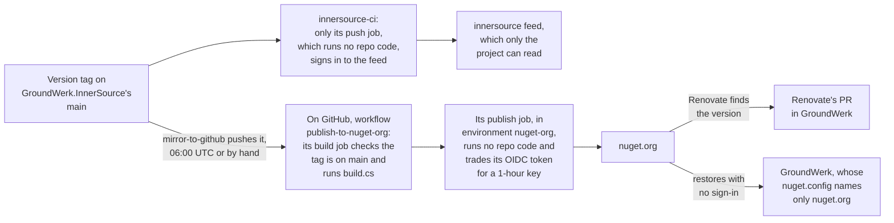

# 14. Releases also go to nuget.org from GitHub, GroundWerk restores only from there, and only a push job signs in to the feed

Status: Accepted

## Context

GroundWerk takes GroundWerk.InnerSource's packages from the innersource feed, which only the project can read, so a clone of GroundWerk's copy on GitHub can't restore them (docs/adr/0009, docs/adr/0013). GitHub Packages needs an access token even to restore a public package. nuget.org's Trusted Publishing trades an OIDC token that GitHub issues to a GitHub Actions job for a nuget.org key that's valid for an hour, so no key is stored or renewed, and the mirror already pushes each version tag to GroundWerk.InnerSource's copy on GitHub. Every build on the ci template up to v1.3.1 also signs in to the feed before it runs the repo's code, so a PR's build.cs and tests, the AI developer's included, can read the build service's token, which can push to the feed (docs/adr/0009).

## Decision

- Workflow publish-to-nuget-org, in GroundWerk.InnerSource's .github/workflows, runs only on GitHub, when the mirror pushes a version tag or when a person runs it on one. Its build job checks that the tag is on main, runs build.cs on that commit and checks that the tag is a version and that each package has it. Its publish job, in environment nuget-org, which only v* tags may deploy to, takes those packages and runs none of the repo's code: NuGet/login trades the job's OIDC token for a key through the Trusted Publishing policy that the nuget.org account holds for that repo, workflow file and environment, and dotnet nuget push pushes them with --skip-duplicate. Each action is pinned to its release's commit ID.
- The environment's secret NUGET_USER holds the nuget.org account's name, and the packages' links to the repo come from GitHub's own variables, so no file names either account.
- Each repo's LICENSE is the MIT license, and each package carries it.
- innersource-ci keeps pushing each PR build's prereleases and each version tag's release to the feed.
- GroundWerk's nuget.config names only nuget.org, so a restore needs no sign-in, and the host moves to GroundWerk.Telemetry 2.0.1, the first release there. 2.0.0's tag is on a commit with no workflow, so 2.0.0 stays only in the feed.
- The ci template, from v2.0.0, signs in to Azure Artifacts only in a second job, push, which runs only in the PR builds and version tags' builds of a repo that names its feed. It checks out nothing, runs none of the repo's code and pushes the packages that the build job hands it as a pipeline artifact, in the same image. GroundWerk names no feed, so its builds never sign in.
- The AI developer's pipeline restores the packages from nuget.org with no sign-in, so it has no token to empty.

## Alternatives considered

- GitHub Packages, which needs an access token to restore even a public package.
- A nuget.org API key stored in GitHub or Azure DevOps, which someone renews by hand, and which anyone who gets it can use until it expires.
- Signing in after build.cs in the build job, where a step's logging commands, such as task.prependpath, can change what the job's later steps run.
- Pushing to the feed through an identity that only innersource-ci may use, so that the build service loses Feed Publisher, which would also stop a PR that changes its pipeline's YAML or reaches its job's own token, but needs a service connection and a story of its own.
- The feed in GroundWerk's nuget.config, mapped to GroundWerk.*, which a clone from GitHub can't read.

## Consequences

- A clone of GroundWerk from GitHub restores and builds with no sign-in.
- GroundWerk restores from nuget.org only because its copy on GitHub is public. A company whose packages stay private names its own feed in nuget.config instead, with nuget.org as that feed's upstream source, so every restore goes through a feed it controls, and it publishes to nuget.org only what it means to make public.
- A release reaches nuget.org at the mirror's next run, at 06:00 UTC or when someone runs it, and Renovate's PR for it follows, since Renovate finds GroundWerk.Telemetry's versions where nuget.config points.
- nuget.org lets an owner unlist a version but not delete it, so each release there is public for good, which ADR 0009's rule that a version is never replaced already expects.
- GitHub makes no push event for tags when more than three are pushed at once, so a mirror run that brings four or more new version tags publishes none of them until someone runs the workflow on each.
- A PR's build.cs and tests no longer run with the feed's sign-in in their environment, but every job still runs as the build service, which keeps Feed Publisher for innersource-ci's pushes, as ADR 0009 says. So a PR in GroundWerk that changes its pipeline's YAML could still sign in, and a PR's code could still reach its job's own token, for example by changing what a later step of the job runs or through the Docker socket that the build job maps for Testcontainers. The packages on nuget.org come from GitHub's own build, so only the feed is at risk.
- GroundWerk.InnerSource's PR builds still push prereleases, from the push job, which pulls the image a second time.
- The packages on nuget.org are built on GitHub's runners from the mirror's copy of the commit, whose ID differs from Azure DevOps's (docs/adr/0013), and each links to that copy and commit.
- The Trusted Publishing policy, the environment and its secret are made by hand on nuget.org and GitHub, so they aren't in Terraform.
